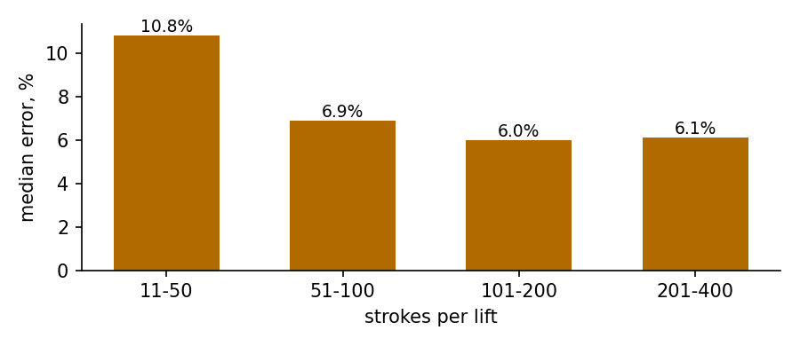
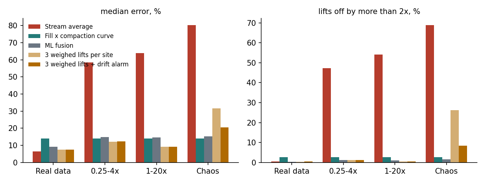

# Part 1: Getting the weight

## The idea

A Europress compactor already knows how many times its ram has pressed. Every stroke pushes one charge of waste from the hopper into the container, so the number of strokes since the last lift says how much waste has gone in. Multiplying that count by the kilos one stroke carries at that site gives the weight in the container:

```
kg = strokes since the last lift x kg per stroke for this site x 1.1
```

The factor 1.1 makes the estimate read about 10% high on purpose. A high reading only moves a lift slightly earlier, while a low reading lets the container overflow, so the error is pushed to the side that costs less. Europress's own simulator confirms this: a gauge that reads 6% high is worth €258 per machine-year, one that reads 6% low only €208 (`results/sim_value.csv`).

A stroke is a press, not a weight. How much one press moves depends on the people using the machine: one site fills the hopper before pressing, another presses after every single box. For this reason each site is taught its own kilos per stroke once, from 3 weighed lifts. After that the estimate runs in the SMART cloud from data the controller already sends, with no permanent scale and no daily operator data.

The concept assumes that real SMART controllers log the stroke count, as the `compaction_cycles` field in the dataset does. The controller starts every stroke, so a machine generation that does not report the count needs a firmware change, not new hardware. This has not been confirmed with Europress.

## Teaching a site

Each site starts from the average kilos per stroke of its waste stream, learned from a few reference machines. In the official dataset these averages are 31.9 kg for biowaste, 27.7 kg for mixed waste, 21.7 kg for paper, 20.6 kg for cardboard, 9.9 kg for plastic film and 8.9 kg for mixed plastic (`results/kg_per_stroke.csv`).

The site's own value comes from its first 3 weighed lifts: the median of weighed kilos divided by strokes. There are two ways to get those weights. The cheaper way is to ask the hauler once, at setup, for the weighbridge tickets of 3 lifts. That needs no hardware and no visit, and in the dataset 13,442 of 18,297 completed lifts already have a ticket. Where the hauler does not share, a Europress technician brings a mobile calibration kit: load pads under the container, calibrated with test weights in the factory, left in place for 3 fills and then moved to the next site. The kit has not been built or tested.

Habits change when staff change, with the seasons or as the machine wears. A drift alarm watches for this by comparing the stroke estimate with an estimate from the fill reading. When the two disagree by more than 2 times for 3 lifts in a row, SMART asks for one new weighing and uses the fill reading until it arrives. In the stress test below this asked for 0.07 to 0.09 re-weighs per machine-year at sites with a stable habit.

## How the estimate checks itself

The stroke count measures mass and the fill reading measures volume, so each can check the other. In a common compactor design the ram runs a fixed stroke and the back pressure at the end of the stroke rises as the container fills (US4643087). The ram travel shortens only near full, so the fill estimate, not the ram travel, is the volume signal. Four checks follow from this.

- **Telemetry coverage.** Missing hourly messages mean missing strokes, which makes the estimate read low. When fewer than 95% of the expected messages have arrived since the last lift, the estimate is marked low confidence and SMART falls back to the fill reading at 90%, the same fallback Europress's simulator uses.
- **Capacity.** A container cannot hold much more than its capacity in kilos, which the dataset's material table gives as volume x compacted density x (1 + compressibility / 2). An estimate above 1.3 times capacity is an over-read, usually strokes from more than one fill, and is marked low confidence. It never blocks a lift call, because the estimate passes the 80% call long before it reaches 1.3 times capacity.
- **Stuck fill sensor.** A fill reading of 85% or more while the strokes say less than 40% of capacity means the fill sensor is stuck. SMART ignores the fill reading and opens a service ticket.
- **Drift.** A lasting disagreement between strokes and fill means the site's habit changed, so SMART asks for a new weighing as described above.

## How accurate it is

`analysis/strokes_eval.py` tests the stroke count on 5,383 lifts of 368 machines with a weighbridge ticket, always using kilos per stroke learned on other machines. The stroke count has a median error of 7.5%, against 13.0% for an estimate from fill x density. More important, it rarely reads low: 2.5% of lifts are underestimated by more than 20%, against 13.7% for fill x density, and the 1.1 setting brings this down to 0.8%.

The error falls as more strokes go into one lift, because the random differences between single charges average out. Lifts with 11 to 50 strokes have a median error of 10.8%, while lifts with 101 to 200 strokes have 6.0%. Biowaste, with a median of 41 strokes per lift, and paper, with 56, sit in the noisiest range. Cardboard, with 115, sits in the best one.



The worst errors come from two sources. Lifts with telemetry gaps, 3.4% of all lifts, are underestimated by more than 20% in 19.1% of cases, against 1.9% with full telemetry, which is why the coverage check exists. The capacity check flags 393 lifts (7.3%) as over-reads, and after it the median error is 6.9% and the 90th percentile drops from 61.0% to 24.7%.

## What accuracy each use needs

The brief's simulation target is about ±100 kg on a 3 t cardboard load. The stroke count does not meet it: only 34.0% of 562 loads between 2.5 and 3.5 t are within ±100 kg, against 77.9% for the dataset's simulated built-in scale (`results/accuracy_use_cases.csv`). Different uses need different accuracy, so the concept uses the stroke count only where it is good enough.

Deciding when to lift needs a ballpark. In Europress's simulator the value of lifting by kilos stays flat up to about 9% median error, so the stroke count at 6.9% to 7.5% is enough. A cost per tonne report for the customer is also fine, with a median error of 7.0% in €/t. Checking an operator's invoice is different: Europress's own example script catches 94.7% of a 10% tonnage overbilling with a 1.5% scale, but only 15.6% with a 10% error (`results/europress_accuracy_example.txt`). So invoice checks stay with reference gauges or weighbridge tickets.

## Stress test: what if every site presses differently?

The dataset gives every site the same pressing habit, which flatters any method that uses one average per stream. `analysis/habits.py` breaks the real stroke counts on purpose and then tests ways to recover the weight. Each site gets a random habit, applied hour by hour, in three scenarios: each site presses 0.25 to 4 times as often per kilo, each site presses 1 to 20 times as often (tiny charges, one box per press), and a chaos case where habits also change up to 3 times a year and empty and idle presses are added. In the chaos case the strokes per machine end up a median 4.3 times the original, and up to 114 times.

In each of 5 rotations, 20% of the machines act as reference machines that teach and the other 80% are scored against their weighbridge tickets, which gives 21,624 scored lifts per scenario. Every estimate uses only the machine's past cycles.



One average per stream does not survive. With different habits, 47% to 69% of lifts are off by more than 2 times. The fill reading, through a compaction curve learned on the reference machines, is not affected by habits at all, but it stays at 14.0% median error. A Kalman filter that learns each site's kilos per stroke from the fill reading ended at 13.6% to 22.2%, no better than the fill reading itself, because the fill sensor's own per-machine bias limits it. Gradient boosting that fuses strokes, fill and the Kalman estimate is the best method that needs no weighing at the site, at 14.6% to 15.2% with only 1% to 2% of lifts off by 2 times.

Teaching each site with 3 weighed lifts brings the error back to 9.1% when sites press 1 to 20 times differently, with 0.4% of lifts off by 2 times. Weighing 1, 3 or 5 lifts gives 10.7%, 9.1% and 8.8%, so the gain flattens after 3. When habits keep changing, the taught value goes stale and the error rises to 31.7%. The drift alarm brings it down to 20.6%. An earlier, stricter alarm setting (1.5 times for 2 lifts) reached 16.5%, but it asked for 0.63 to 1.87 re-weighs per machine-year, and the costing below shows that this would eat most of the value.

Two more methods were tried and not adopted. Conformal prediction gave each fused estimate a 90% range, but the ranges covered only 86% to 87% of true weights and spanned about 2 times from low to high. Inverse-variance fusion of the Kalman estimate and the fill curve landed at 12.6% to 14.2%, close to the fill reading alone.

The habits are injected by this work, not observed, and only a pilot can show how far real sites differ.

## Retrofit and cost

Three retrofit paths cover the installed base. SMART-connected machines whose controller already reports strokes need only the cloud software. Connected machines that do not report strokes need a firmware release per controller generation, which the controller can take remotely if it supports remote updates. Machines that are not connected, or of another brand, need a telemetry retrofit unit plus a stroke counter, for example a current sensor on the pump motor supply where each stroke shows as one load peak. Counting compactor strokes from motor energy is described in KAPASITY Oy's application WO2021176137A1, where the count serves fullness, not weight, and motor current per cycle was used for fullness already in US5558013A. The third path is not tested in this work.

The cost of teaching one site with the kit, without operator data, adds up from five figures. The kit is priced from one listed roll-off container scale with four load cells, €4,800 to €5,620 excluding VAT (the listing shows both prices). Three fills take a median of 21.0 days in the replay, so one kit could teach up to 17 sites a year, and 12 is used as a realistic lower figure. Over an assumed 5-year life that is €55 to €94 per site. Two technician visits of an assumed 1.5 hours each cost €117 at the average Finnish private-sector labor cost of €39.0 per hour in 2024 (Statistics Finland). Driving the dataset's median site round trip of 28 km twice costs €30.8 at the 2026 tax-free allowance of €0.55 per km. Teaching a site costs about €203 to €242 once.

A re-weigh after a drift alarm costs about €169: the same two visits plus 7 days of kit use. With the drift alarm at 2 times for 3 lifts, stable sites need 0.07 to 0.09 re-weighs per machine-year, about €12 to €15 a year. A chaotic site needs 0.57, about €97 a year. Against €225 per machine-year of simulated value, a taught site pays back in about 1 to 1.15 years. A permanent scale costing €4,800 to €5,620 per machine would need 20 to 23.5 years to pay back from the €239 a real gauge adds, before installation.

The software is the main fixed cost. Its effort is not known: one person-month costs about €6,240 at the same average labor cost, and software developers likely cost more. If a production feature took 6 to 12 person-months, that would be €37,000 to €75,000, but this is a guess, not an estimate from data. Kit engineering for DUO rails and COMBI feet, transport of kits and cloud compute are not priced.

## Reference gauges

A few machines per stream and region carry a permanent gauge as reference instruments. On a COMBI, where the truck lifts the whole unit, load pins in the unit's feet or roller axles travel with it and read zero when lifted, which gives a free zero check at every pickup. On a DUO, where the container slides onto rails at the compactor, load cells sit under the rails and need stops against the pulling force of the hookloader. Load-cell weighing of compactor containers is established prior art (BACE, US10564029B2; Canalytics, US12379240B1), so the gauge is not the new part. It is the instrument that teaches the stream averages and checks tonnage where a customer needs it.

## Sources of error

Most errors fall into two groups. Some make the estimate read low, which is the harmful direction: lost telemetry, a pallet or other heavy item in one stroke, and rain or wet waste that adds mass without strokes. The coverage check and the 98% fill stop protect against overflow from these, while heavy charges and rain are not tested. Others make it read high, which costs an early lift: extra, empty or idle presses, a partial lift that does not reset the count, and a stuck fill sensor that orders lifts. Per-site teaching, the capacity check and the watchdog handle these. A wrongly configured waste stream gives a wrong start value, which the site's own weighings replace.

## Validation plan

1. **Desk check, one day.** Repeat `analysis/strokes_eval.py` on Europress's real cycle counts and any weighbridge tickets customers already share. The pass mark is a median error at or below 9% per stream.
2. **Pilot, 8 to 12 weeks.** 20 to 30 machines in plastic film, cardboard and mixed waste, where the value is highest. Each site is taught with 3 weighed lifts, then every lift is weighed by one cooperating operator or the kit. The key real-world numbers are how far kilos per stroke differ between sites and how stable they stay at one site.
3. **Metrics.** Median error, 90th percentile error, signed bias, the share of lifts more than 20% low and more than 20% high, and re-weighs per machine-year. Machines being scored never teach.
4. **Proposed targets.** Median error at or below 9%, and at most 3% of lifts more than 20% low after the 1.1 setting. These are targets, not results.
5. **Decision test.** Run the kilo trigger against the fill trigger on matched pilot sites and compare lifts per tonne and overflow events.
