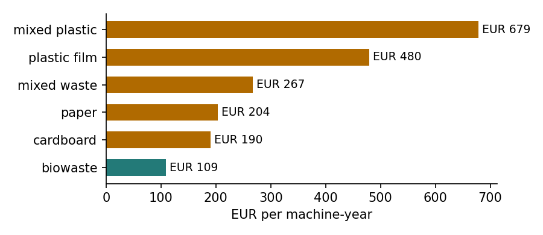
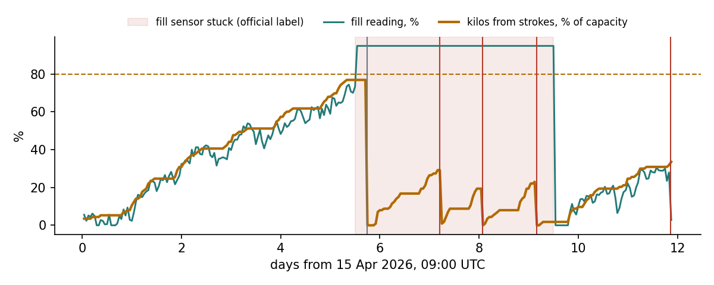
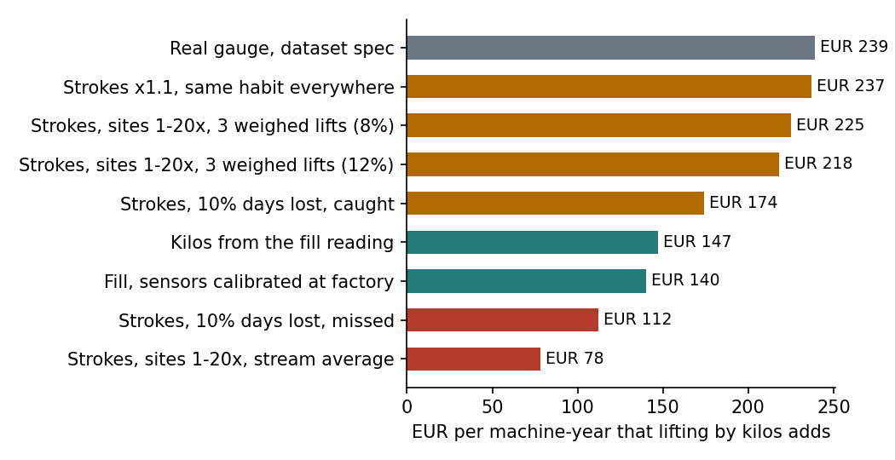
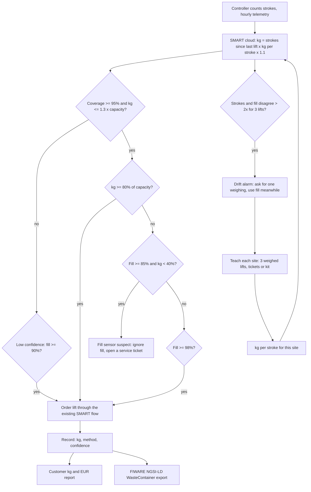

# Part 2: What the weight is worth, how it runs in SMART, and what Europress can build on it

All figures come from Europress's synthetic dataset and public generator, with the dataset's hypothetical prices. Each figure names the script and the result file it comes from.

## Where the money is lost today

Customers pay a fixed fee for every lift, so a lift that comes early charges a full fee for a partly empty container. The official labels count 1,854 such unnecessary lifts between 1 October 2025 and 30 June 2026, worth €274,760 (`results/premature_lifts.csv`). Most of them, 1,216 lifts and €171,037, are plain over-servicing. Another 295 lifts and €53,328 come from fill sensors stuck at a high reading, and 343 lifts and €50,395 from precautionary orders.

The fill reading causes much of this. In Europress's own model every machine has its own gain and offset error, and plastics spring back after pressing, so their fill reads 4 to 5 points high. A lift ordered at a fill threshold then comes before the container is full in kilos.

## What lifting by kilos adds

Europress's decision simulator offers a kilo trigger that lifts at 80% of the container's capacity in kilos. On the 3,573 official decision cases it adds 23.4% on top of the best decision available without weight, which is €262 per machine-year across all streams (`results/value_by_stream.csv`). The gain follows the fill error. Mixed plastic gains €679 and plastic film €480 per machine-year, because their fill reads high, while biowaste gains only €109.

For one customer the gain adds up over its machines (`results/value_by_customer.csv`). The 52 customers have a median of 3 machines with decision cases, and the median customer gains €672.5 a year. The top tenth gain €5,533 or more, and the largest customer, with 54 machines, gains €11,431.

## The sensor that froze: one machine, five days

CMP-00168 is a 12 m³ DUO cardboard compactor belonging to customer ORG-0023, whose 31 machines would gain €7,112 a year. On 20 April 2026 at 21:00 UTC its fill sensor stuck at 94.9% and stayed there for four days, which the official label calls a false-high fill reading caused by bridging or obstruction (`results/replay_trace.json`).

SMART kept trusting the stuck reading and ordered four lifts within five days. The strokes told a different story: they put the container at 748 kg, 499 kg, 589 kg and then 816 kg, between 19% and 32% of its 2,565 kg capacity, and the dataset's own gauge agreed with 620 kg, 495 kg, 475 kg and 695 kg. All four lifts are labeled unnecessary, with €871.19 at stake. SMART Weight would have held all four. Its watchdog flagged the fill sensor on 21 April at 09:00, 29 hours before the first unnecessary lift, and kept flagging it after each lift until the sensor recovered.

## One lift traced from strokes to euros

Lift COL-00168-0034 on 23 April shows how each number follows from the one before it.

1. The machine reported 22 strokes in the 20 hours since its previous lift (`telemetry_dedup.compaction_cycles`, `results/replay_cycles.csv`).
2. Cardboard carries 20.6 kg per stroke (`results/kg_per_stroke.csv`), so with the 1.1 setting the estimate is 22 x 20.6 x 1.1 = 498.5 kg.
3. The 12 m³ container holds 12 x 190 x (1 + 0.25 / 2) = 2,565 kg of cardboard (`configs/assumptions.yaml`), so it was 19.4% full in kilos, far below the 80% call.
4. Telemetry was complete and the estimate was below 1.3 times capacity, so confidence was normal.
5. The fill reading said 94.9% while the kilos said under 40%, so the watchdog had marked the fill sensor as stuck.
6. The dataset's gauge read 495 kg before the lift, 0.7% below the estimate.
7. The official label marks the lift unnecessary because of the false-high fill reading, with €225.44 at stake (`anomaly_labels`).

## How good the weight has to be

`sim/experiments.py` rebuilds Europress's world 25 times with its public generator (seed 31337, 250 machines, one year, 1,851 decisions) and changes one thing per run. The best value without weight is €142,557 in every run, so only the tested change differs (`results/sim_value.csv`).

Four results shape the concept. A ballpark is enough: a gauge with 8.6% median error is worth €246, as much as the dataset's 1.3% gauge at €239, and value only drops at 17% error, to €186. Reading low hurts while reading high does not, which is why the stroke count is set 10% high, and that setting lifts the plain stroke count from €198 to €237, 99% of the gauge. Lost telemetry is the one stroke failure that hurts badly: 10% of days lost unnoticed gives €112, while catching it and falling back to fill gives €174. Finally, pressing habits decide everything. When sites press 1 to 20 times differently, one average per stream gives only €78, while teaching each site with 3 weighed lifts gives €225 with an 8% site error and €218 with 12%.

The fill reading cannot replace the strokes. Kilos estimated from the fill reading give €147, and calibrating every fill sensor at the factory does not help, at €140, because the fill reading is too coarse to carry mass.

## SMART workflow

Every record leaves SMART as a FIWARE Smart Data Models `WasteContainer` entity in NGSI-LD (`analysis/fiware_export.py`). The weight carries its method (`estimated:stroke-count`), its confidence, the kilos per stroke and the stroke count, so a city, a recycler or the customer can always see that the figure is an estimate and how it was made. Records for all 447 machines pass the schema, apart from the location, which the synthetic sites lack. Of the 447, 23 are marked low confidence for telemetry gaps and 3 as over-reads.

## The rules on a year of SMART data

`smart/replay.py` runs the rules above hour by hour on the dataset's telemetry for all 447 machines and 17,842 fill cycles. Each hourly value uses only the readings up to that hour, so the same code can run as a live service in the SMART cloud. The replay uses one kilos per stroke per stream, because in this dataset every site presses alike, and there per-stream and per-site values agree (6.5% and 7.5% median error in `results/habits_eval.csv`).

The replay shows when lifts really happen, measured in kilos (`results/replay_by_trigger.csv`). On-call lifts ordered by the fill reading come at a median of 80.4% of capacity, and 49.2% of them before the 80% call. Fixed-schedule lifts come at 51.9%, and 83.0% of them before the call, so the 4,752 scheduled fill cycles lift containers that are about half full. Maximum-interval lifts come at 54.5%, which may be contractual or hygienic and cannot all be avoided.

Against the official labels, the strokes hold up well. Of the 1,854 labeled unnecessary lifts, 1,777 end a complete fill cycle, and at 1,713 of those (96.4%) the stroke estimate was below the 80% call, so SMART Weight would have held them. They carry €253,091 of the €262,849 at stake. Holding a lift is not the whole saving, because the next lift still comes, which is why the simulator, not this count, gives the net value. The rule is also selective: on on-call lifts it holds 97.2% of the labeled unnecessary ones and 43.0% of the others.

Customers who had to call for an extra lift show the other side. In 508 ad hoc customer calls the median fill reading was 96.9%, and in 79.3% of them the kilo call had already fired, a median of 49 hours before the lift. The watchdog fired in 274 of the 312 labeled stuck-sensor periods (87.8%), and 85.4% of its alarm hours fell inside such a period.

## What the data makes possible for Europress

Once SMART Weight runs, Europress collects more than a weight per lift. It learns how hard and how often each machine is used, how each site presses, when strokes and fill disagree, and how all of this moves with the seasons. This data serves Europress's own service, sales and product teams as well as its customers and partners. Some of the uses below are tested in this work, and the others are marked as ideas.

**Service planned by use, not by calendar.** Machines differ hugely in how hard they work. Over the year, the busiest tenth of machines pressed 10,260 times or more, while the quietest tenth pressed 830 times or fewer, a 12.4-fold spread (`results/data_uses.json`). With such a spread, a fixed service interval comes too early for most machines and too late for the busiest ones. Planning ram seals, hydraulic oil and inspections by stroke count would put service visits where the wear is, which lowers Europress's service cost and avoids breakdowns that customers notice. The synthetic data does not link breakdowns to use (corrective work orders range from 1.18 to 1.41 per machine across the four use quartiles), so this benefit is untested here. The stuck-sensor watchdog is the tested part of the same idea: it turns a disagreement between strokes and fill into a service ticket before the customer pays for empty lifts.

**Sales leads from the machine's own behavior.** The kilos at each lift show which machines do not fit their sites. In the replay, 88 of 447 machines are usually lifted below half their capacity by the stroke estimate, while 46 are usually past full. The first group may be over-serviced or too large, the second too small. Both are concrete reasons for a sales call: a different container size, a second machine, or a move from a fixed schedule to on-call lifting by kilos, which the 4,752 half-full scheduled lifts above make a clear case for.

**Better service to the customer.** The customer gets a kilo record per lift and a monthly report of kilos and cost per tonne by waste stream, which no operator invoice gives today. Pressing habits are part of that report. A site that presses after every box wears the machine and uses energy for little gain, and a short note to the site manager can change that. The drift alarm also shows when a site's habit has changed, for example after a new tenant or new staff.

**Weather and seasons.** Rain adds water mass without strokes, and holidays and summer shutdowns stop the strokes altogether. The dataset's site calendar records closures, and the Finnish Meteorological Institute publishes its data sets freely for public use, so both can feed a kilo forecast per site. In this dataset, sites that store material outdoors show kilos per stroke that differ from indoor sites by 3.4% or less in every stream (`results/data_uses.json`), so the rain effect is too small to see here and the forecast is untested.

**Product development.** Real stroke counts, pressing habits and fill curves per waste stream tell Europress's engineers how machines are actually used: how often the ram runs half empty, which hopper sizes fit which sites, and where a pressure-based detector for empty presses would pay off. This feedback costs nothing extra once the data flows.

**Partners and new data products.** Haulers could plan routes and truck loads from kilos per site ahead of each lift, recyclers could see incoming material by stream, and cities get the same records through the open FIWARE format. Aggregated and anonymized kilo flows by region and stream could become a data product of their own. These uses depend on customer consent and on what customers allow Europress to share, which is a contractual question, not a technical one. All of them are untested.

**What stays out of reach.** Disputing an operator's invoice needs about 1.5% accuracy, which the stroke count does not reach. Customers who need it can buy a reference gauge, which turns a limit of the concept into an option to sell.

## Product, revenue and rollout

SMART Weight is sold as a software add-on for connected machines. It bundles lift timing by kilos, the stuck-sensor watchdog and a kilo record per lift with method and confidence, and each site is taught once at setup. The price is a hypothesis: at €225 per machine-year of simulated value, a third of the saving would be about €75 per machine-year, and the simulated customer value per 1,000 connected machines is about €225,000 a year at the dataset's prices.

Europress earns in four ways. The subscription is recurring revenue on machines already sold. The watchdog and use-based service plans bring service work to Europress's own technicians. The right-sizing leads and the move from schedules to on-call lifting create sales. Reference gauges become an option for customers who need tonnage checks. In return Europress provides the calibration kits or ticket requests, a few reference gauges, and the upkeep of the models.

The rollout keeps the risk low at each step.

1. **Desk check, one day.** Run `analysis/strokes_eval.py` on Europress's real cycle counts and shared tickets. Pass mark: median error at or below 9% per stream.
2. **Pilot, 8 to 12 weeks.** 20 to 30 machines in plastic film, mixed plastic and mixed waste, where the value is highest. Pass marks: the targets in `docs/concept.md`, fewer lifts per tonne and no added overflow.
3. **Launch on connected machines.** A software update, with each site taught by 3 tickets or the kit. Plastics and mixed waste first, then cardboard, paper and biowaste.
4. **Reference network.** A few gauged machines per stream and region keep the stream averages up to date.
5. **Unconnected and other-brand machines.** A retrofit unit with a motor-current stroke counter, after its own pilot.

The main risks and their answers are known. Real controllers might not report strokes, which the desk check settles on day one and a firmware release fixes. Operators paid per lift lose lifts, so the sales story is fuller trucks and a lower cost per tonne, starting with customers who order their own lifts. A customer might treat the estimate as a billing weight, so every record says "estimated", and billing stays on the weighbridge. Real sites may press more erratically than any scenario tested here, which per-site teaching, the drift alarm and the pilot address. Sites waiting for their 3 weighings run on the fill reading or the gradient-boosting fallback until they are taught.

## Where AI is used

In the product, kilos per stroke are learned per site from 3 weighed lifts, starting from a stream average learned on reference machines. A drift alarm and a stuck-sensor watchdog compare mass with volume, and every figure carries a confidence. Gradient boosting that fuses strokes, the fill reading and a Kalman estimate is kept as the fallback for sites not yet taught, at about 15% median error.

Three methods were tested and not adopted: a Kalman filter that learns each site from the fill reading alone, inverse-variance fusion, and conformal 90% ranges, which covered only 86% to 87% of true weights. The next step is reading each stroke's hydraulic pressure curve. The point where pressure starts to rise shows how big the charge was, and a press on an empty hopper never builds pressure, so the curve measures charge volume and flags empty presses. A model can learn this from lift totals alone, because the strokes of one lift must add up to its weight (learning from aggregate observations, arXiv 2004.06316). The dataset contains no pressure curves, so this remains untested.
